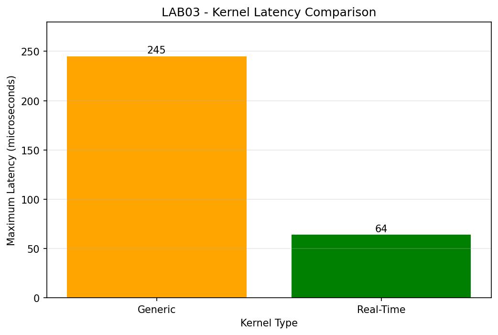

# LOS201 - Embedded Linux Labs

## Student Information

- **Name:** Nguyen Tran Nam Nguyen
- **Student ID:** SE205174
- **Group:** 10

## Course

Embedded Linux Systems (LOS201)

## Lab Assignments

| Lab | Description | Status |
|-----|-------------|--------|
| [LAB01](LAB01/) | Linux Kernel, U-Boot, BusyBox, QEMU | Completed |
| [LAB02](LAB02/) | Device Driver and Filesystem Management | Completed |
| LAB03 | Coming soon | Pending |

---

## LAB01 - Embedded Linux System

### Technologies

- Linux Kernel 5.15
- U-Boot 2022.04
- BusyBox 1.35.0
- ARM Cortex-A9
- QEMU vexpress-a9

### Description

Build and configure an Embedded Linux system using Linux Kernel,
U-Boot, BusyBox, and QEMU.

### Files

- [LAB01 Source and Output](LAB01/)
- [LAB01 Report](LAB01/bao_cao/)

---

## LAB02 - Device Driver and Filesystem Management

### Technologies

- Linux Kernel 5.15
- ARM Cortex-A9
- QEMU vexpress-a9
- Linux Character Device Driver
- procfs and sysfs
- MTD and JFFS2
- BusyBox init

### Part A - Character Device Driver

Develop a Linux kernel module named `lab2_driver.ko`.

Features:

- Register a character device with major number 240.
- Create `/dev/lab2`.
- Implement open, read, write, and release operations.
- Exchange data between user space and kernel space.

### Part B - procfs and sysfs

Provide driver information through:

- `/proc/lab2_info`
- `/sys/class/lab2_class/lab2/status`

Display device information such as:

- Major number
- Open count
- Buffer length

### Part C - MTD and JFFS2

- Simulate NAND flash using nandsim.
- Create and mount a JFFS2 filesystem.
- Test file persistence after unmounting and remounting.

### Part D - BusyBox Init

- Configure BusyBox init scripts.
- Automatically load the kernel module during boot.
- Automatically create the device node.
- Test the driver in QEMU.

### Results

- Kernel module successfully compiled for ARM.
- Character device successfully tested.
- procfs and sysfs interfaces verified.
- Module loading and unloading verified.
- MTD/JFFS2 filesystem tested.
- BusyBox initialization tested.

### Files

- [LAB02 Project](LAB02/)
- [LAB02 Driver Source](LAB02/driver/)
- [LAB02 Report and Screenshots](LAB02/bao_cao/)

---

## Repository Structure

```text
LOS201/
├── LAB01/
│   ├── bao_cao/
│   ├── configs/
│   ├── output/
│   └── rootfs/
│
├── LAB02/
│   ├── bao_cao/
│   ├── configs/
│   ├── driver/
│   ├── mtd/
│   ├── output/
│   └── rootfs/
│
└── README.md
```

## Author

**Nguyen Tran Nam Nguyen**

Student ID: SE205174

Course: Embedded Linux Systems (LOS201)# LOS201 - Embedded Linux Labs

## Student Information
- Name: Nguyen Tran Nam Nguyen
- Student ID: SE205174
- Group: 10

## Course
Embedded Linux Systems

## Lab Assignments

| Lab | Description | Status |
|-----|-------------|--------|
| LAB01 | Linux Kernel, U-Boot, BusyBox, QEMU | Completed |
| LAB02 | Coming soon | Pending |
| LAB03 | Coming soon | Pending |

## LAB01
- Linux Kernel 5.15
- U-Boot 2022.04
- BusyBox 1.35.0
- ARM Cortex-A9
- QEMU vexpress-a9
---

## LAB03 – Debugging, Profiling and Real-Time Analysis

### 1. Objectives

This lab focuses on debugging, memory analysis, performance
profiling, and real-time latency measurement in Linux.

### 2. Part A – Remote Debugging with GDB

Tools:
- QEMU ARM Cortex-A9
- gdbserver
- gdb-multiarch

Three bugs were investigated and fixed:

| Bug | Cause | Solution |
|---|---|---|
| Array Out of Bounds | Loop condition `i <= len` | Change to `i < len` |
| Use After Free | Memory freed before use | Free memory after use |
| Integer Overflow | 32-bit integer multiplication | Use `long long` |

**GDB log:** [gdb_session.txt](LAB03/logs/gdb_session.txt)

### 3. Part B – Memory Analysis with Valgrind

Before fixing:
- Definitely lost: 16,900 bytes in 250 blocks.
- Error summary: 3 errors.

After fixing:
- No memory leaks detected.
- Error summary: 0 errors.

**Results:**
- [Before fixing](LAB03/logs/valgrind_report.txt)
- [After fixing](LAB03/logs/valgrind_fixed.txt)

### 4. Part C – System Call Tracing and Profiling

Tools:
- strace
- perf

Results:
- [Strace summary](LAB03/logs/strace_summary.txt)
- [Perf report](LAB03/logs/perf_report.txt)
- [Perf statistics](LAB03/logs/perf_stat.txt)

### 5. Part D – Real-Time Latency Analysis

Tool: cyclictest

Test environments:
- Generic Kernel: `7.0.0-38-generic`
- PREEMPT_RT Kernel: `7.0.0-38-realtime`

| Kernel | Maximum Latency |
|---|---|
| Generic | 245 µs |
| PREEMPT_RT | 64 µs |

In these tests, PREEMPT_RT reduced the observed maximum
latency by approximately 73.9%.



### 6. LAB03 Report

[View LAB03 PDF Report](LAB03/bao_cao/SE205174_Lab03_BaoCao.pdf)

### 7. LAB03 Directory Structure

```text
LAB03/
├── apps/
├── logs/
├── bao_cao/
│   └── SE205174_Lab03_BaoCao.pdf
└── output/
    └── initramfs_lab3.cpio.gz
```
